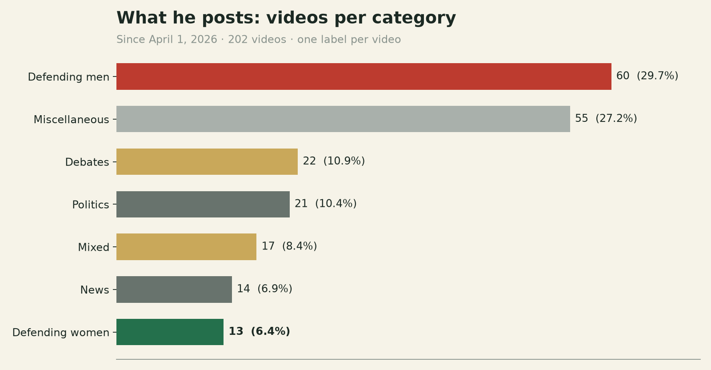
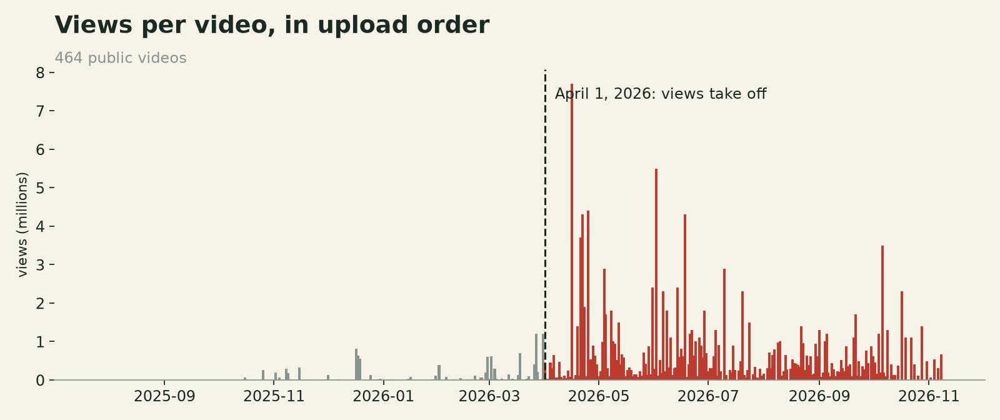
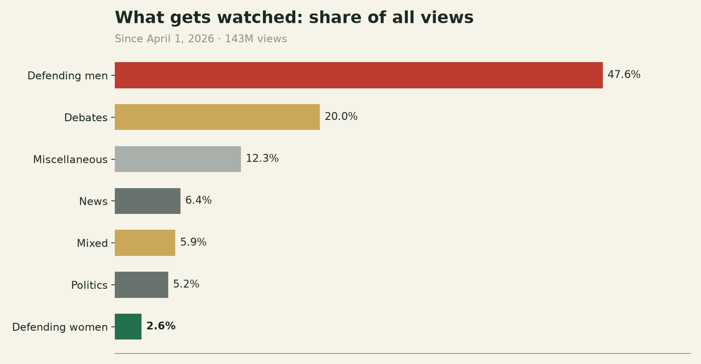
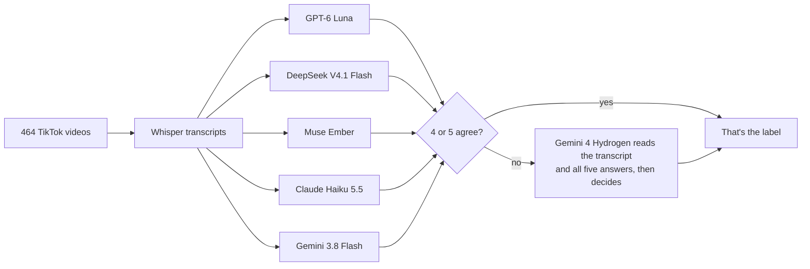

<div align="center">

# How to Analyze TikToks Using AI

**Download every video a creator has posted, transcribe it, and have five AI models label what each one is about. Then check the labels against the creator's own.**

<br />

[](https://nexustrade.io/ilyas)
[](data/posts.csv)
[](models.json)
[](LICENSE)

<br />



<br />

| | Videos | Defending men | Defending women | Views on videos defending men | Views on videos defending women | Million-view videos defending women |
| --- | ---: | ---: | ---: | ---: | ---: | ---: |
| **His last 60** (his example) | 60 | **22** (1st) | **8** (tied 2nd) | | | |
| **All videos** | 464 | **122** (2nd) | **18** (6th) | **47.1%** | **2.5%** | **0 of 43** |
| **Since April 1, 2026** | 202 | **60** (1st) | **13** (7th) | **47.6%** | **2.6%** | **0 of 41** |

<sub>One label per video, the way the creator counts. On his own 60 videos the pipeline counts the same number of "defending women" videos he does (8), and 7 of the 8 are the same videos. Agreement with his per-video labels on 30 held-out videos: <b>25 of 30</b>.</sub>

<br />

**Quick start:** `pip install -r requirements.txt` → `python3 src/labels.py && python3 src/count.py`

</div>

---

## Contents

- [What is this?](#what-is-this)
- [The question](#the-question)
- [Results](#results)
- [Close calls: watch them and decide](#close-calls-watch-them-and-decide)
- [What counts as "defending women"](#what-counts-as-defending-women)
- [How the labels were made](#how-the-labels-were-made)
- [How well it matches the creator](#how-well-it-matches-the-creator)
- [What I fixed along the way](#what-i-fixed-along-the-way)
- [Known disagreements](#known-disagreements)
- [Re-run with rules in his favor](#re-run-with-rules-in-his-favor)
- [How to audit a label](#how-to-audit-a-label)
- [Reproduce it](#reproduce-it)
- [Analyze any creator](#analyze-any-creator)
- [What's inside](#whats-inside)
- [Cost](#cost)

---

## What is this?

An open-source pipeline for answering a simple question about any TikTok creator: **what do they actually post, and what do people actually watch?**

| | |
| --- | --- |
| **1. Collect** | Lists every public video on a profile with its date, views and caption ([`src/collect.py`](src/collect.py)). |
| **2. Transcribe** | Turns each video's audio into a timestamped transcript with Whisper ([`src/transcribe.py`](src/transcribe.py)). |
| **3. Label** | Five AI models label every video independently; a sixth settles disagreements ([`src/classify.py`](src/classify.py), [`src/adjudicate.py`](src/adjudicate.py)). |
| **4. Check** | Scores the labels against the creator's own, counts videos and views per category, and lists the close calls ([`src/score.py`](src/score.py), [`src/count.py`](src/count.py), [`src/close_calls.py`](src/close_calls.py)). |

The code talks to any **OpenAI-compatible API**. Point it at [OpenRouter](https://openrouter.ai) with one key and every model in [`models.json`](models.json) works.

This repo ships with a complete, real run: **all 464 public videos TikTok creator Ilyas Abdulin posted before his November 10, 2026 self-audit** (461 listed by yt-dlp, plus 3 the listing missed that were recovered by hand from his profile), every transcript, the exact prompts, and every answer every model gave.

---

## The question

In November 2026, Ilyas Abdulin posted a video answering people who say he only defends men. He labeled his last 60 videos himself and said:

> "It's also not true that I never defend women. I do, and at least in this example, claims about women is the second biggest category on my channel."

He also invited people to check his work:

> "You're welcome to challenge my methods or even do your own research."

So this repo checks it three ways: on **his own 60 videos**, on **all 464 of his videos**, and on **every video since April 1, 2026**, when his views took off.



---

## Results

There are two labeling runs. The tables below are the **published run**. The **fair run** re-labels all 464 videos with rules written in his favor ([details](#re-run-with-rules-in-his-favor)); it changes 28 labels and not the conclusion.

| Run | Prompts | Labels | Defending women, all 464 | Since April 1 | Agreement with his own labels (tuning / held-out) |
| --- | --- | --- | ---: | ---: | ---: |
| Published | [`prompts/`](prompts/) | [`results/labels.csv`](results/labels.csv) | 18 (6th of 7) | 13 (7th of 7) | 29/30 · 25/30 |
| Fair, in his favor | [`prompts/runs/fair/`](prompts/runs/fair/) | [`results/runs/fair/labels.csv`](results/runs/fair/labels.csv) | 21 (6th of 7) | 16 (6th of 7) | 29/30 · 25/30 |

### In his own example, he's right

| Category | His own count | This pipeline |
| --- | ---: | ---: |
| Defending men | 22 | 22 |
| **Defending women** | **8** | **8** |
| News | 7 | 8 |
| Politics | 7 | 7 |
| Debates | 5 | 5 |
| Mixed | 4 | 5 |
| Miscellaneous | 3 | 5 |

<sub>His count merges related videos into one: three Cornell case videos count as one, two French riots videos as one, and two videos on the same gender-perception claim as one. That is why it adds up to 56.</sub>

In his count, defending women is clearly **second**; in mine it ties for second with news. Both count 8 videos defending women, and 7 of the 8 are the same videos.

### Across his channel, it's near the bottom

| Category | All 464 videos | Share of views | 1M+ videos | Since April 1 | Share of views | 1M+ videos |
| --- | ---: | ---: | ---: | ---: | ---: | ---: |
| Defending men | 122 | **47.1%** | **22 of 43** | 60 | **47.6%** | **21 of 41** |
| Miscellaneous (mostly dating and relationship advice) | 242 | 15.1% | 3 | 55 | 12.3% | 2 |
| Debates with other creators | 22 | 18.5% | 12 | 22 | 20.0% | 12 |
| Politics | 21 | 4.9% | 2 | 21 | 5.2% | 2 |
| Mixed | 22 | 5.9% | 1 | 17 | 5.9% | 1 |
| News | 17 | 5.9% | 3 | 14 | 6.4% | 3 |
| **Defending women** | **18** | **2.5%** | **0 of 43** | **13** | **2.6%** | **0 of 41** |



- **His last 60 videos are not the whole picture.** He has 464 public videos, 202 of them since April 1; the last 60 cover only August 27 to November 8.
- **Defending women ranks 6th of 7 across all his videos and 7th since April 1.**
- **He posts about 7 times as many videos defending men** across his channel (122 to 18), and about 5 times as many since April 1 (60 to 13).
- **Almost half of all his views** go to videos defending men. Videos defending women get **2.5%**.
- **None of his 43 million-view videos** defends women with one label per video. (Counting a video in every category most models list, one does.)

> **Check it yourself:** `python3 src/count.py --since 2025-01-01` prints the all-videos numbers and `python3 src/count.py` the since-April numbers, both from [`results/labels.csv`](results/labels.csv).

---

## Close calls: watch them and decide

The rank of "defending women" depends on judgment calls, and AI models are not the final word. So **[`results/close-calls.csv`](results/close-calls.csv)** lists every video where at least 2 of the 5 models list "defending women" as their first or second choice, but fewer than 4 pick it first: **39 videos**, 15 of them since April 1.

Each row has the link, the claim he's answering, all five votes, the final label, the referee's reason, and **where to watch** (the median of the models' timestamps for where he makes his point). Videos labeled defending women on a 4-of-5 vote are in [`results/labels.csv`](results/labels.csv) with every vote. Watch them. If you'd count one differently, open an issue with the video id.

> `python3 src/close_calls.py` rebuilds the list.

---

## What counts as "defending women"

| Category | Definition |
| --- | --- |
| **Defending women** | He pushes back on a claim that is **negative or unfair to women**: one that runs women down ("women are bad at math"), blames women for men's problems, or denies women's disadvantages. It counts even when he partly agrees. |
| **Defending men** | The exact mirror. |
| **Mixed** | The claim targets both sexes, or neither. |

**Direction decides it, not topic.** A video can be entirely about women and still not defend them. In his "Stereotypes About Women" series, a woman often claims women are *better* with money or collaborate better than men, and he fact-checks *her*. That is mixed, not defending women.

This matches how he described his own examples in his self-audit ("I challenged claims that reflected negatively on women"), and on his 60 videos it gives the same count he does. The full rules are in [`prompts/voter.md`](prompts/voter.md).

**The rank moves with the counting rule; the views barely do.** With one label per video, defending women gets 2.5% of his views and none of his million-view videos. Counting a video in every category that at least 3 of the 5 models list, it gets 5.4% of his views, one million-view video, and ranks 4th across his channel (`multi_label_check` in the summary files).

---

## How the labels were made



1. **His categories.** The [voter prompt](prompts/voter.md) uses the seven categories from his own video: defending men, defending women, mixed, debates, news, politics and miscellaneous.
2. **Men and women are mirror images.** Every rule that puts a video in "defending men" puts the mirror-image video in "defending women".
3. **No answers leak in.** Every example inside the prompts is invented. None is one of his videos.
4. **Five independent voters.** Five models from five companies label every video. Each returns a category, a close second when it's a judgment call, the claim he's answering, a one-sentence reason, and the second of the video where he makes his point.
5. **A referee for disagreements.** When fewer than four voters agree (78 of 464 videos), Gemini 4 Hydrogen reads the transcript, all five answers and the same rules, and decides from the transcript, not by counting votes ([referee prompt](prompts/adjudicator.md)).
6. **One label per video**, the same way he counted in his own chart.

---

## How well it matches the creator

His own labels for his last 60 videos are the answer key ([`data/his-labels.json`](data/his-labels.json), transcribed from the spreadsheet in his video). Before this run, those 60 were split at random into two groups of 30 ([`data/split.json`](data/split.json)). The first 30 were used to tune the prompts; the other 30 were scored afterward.

| | Tuning 30 | Held-out 30 |
| --- | ---: | ---: |
| **Final label** | **29 / 30** | **25 / 30** |
| GPT-6 Luna alone | 28 / 30 | 25 / 30 |
| Muse Ember alone | 28 / 30 | 25 / 30 |
| Gemini 3.8 Flash alone | 28 / 30 | 25 / 30 |
| DeepSeek V4.1 Flash alone | 28 / 30 | 24 / 30 |
| Claude Haiku 5.5 alone | 17 / 30 | 16 / 30 |

Run `python3 src/score.py --set holdout` to reproduce it.

---

## What I fixed along the way

This was not a one-shot run. Every change is listed so you can judge it.

| Change | Why |
| --- | --- |
| Rewrote the men/women rules as exact mirror images | The first prompt said debunking a claim that blames men counts as defending men, with no mirror rule for women. |
| Removed every example taken from his videos | Examples from his own 60 would leak answers into the test. |
| Elections and religious claims count as politics, even when they're news | That's how he labels them. |
| A claim against one sex stays that sex even when he answers "both sexes" | He labeled "prejudice against men is fine" as defending men, not mixed. |
| Videos about his own account (a ban, a strike) are miscellaneous | That's how he labels them. |
| Rewrote the referee prompt to read who the **claim** targets | The first referee decided some videos from the shape of his answer instead of the claim. |
| Made **direction** decide the category, not topic | An independent review of the borderline videos found that many "Stereotypes About Women" videos fact-check a *pro-women* claim. Counting those as defending women did not match his own description ("claims that reflected negatively on women"). Re-run on all 464 videos. |

Each change was checked against his own labels before the next run.

---

## Known disagreements

- **"Do Women Actually Make Men Dumber?"** He labels it defending women. Four of the five models say defending men: the claim is about men's thinking, and his correction protects men from an overgeneralization. It is in the close-calls list.
- **"Is Hypergamy Real? He Bet $1,000 That Women Are Not Hypergamous"** is labeled mixed. Reading the transcript, the claim he answers is that men invented hypergamy to manipulate women, so defending men is arguably better.

If you find another one, open an issue with the video id and the second of the transcript that shows it.

---

## Re-run with rules in his favor

His strongest example, the [Lamine Yamal video](https://www.tiktok.com/@ilyas.abdulin/video/7666031724060495126), debunks a fake rumor about one specific woman. The published rules labeled it news, because "defending women" meant answering a claim about women as a group. That is a defensible line, but it is a line I drew, so I re-ran everything with rules that count it, and wrote real edge cases from his channel into the examples. Every change applies to men identically. The exact changes, and why none of the example videos can affect the score against his labels, are in [`prompts/runs/fair/CHANGES.md`](prompts/runs/fair/CHANGES.md).

| Category | All 464, published | All 464, fair | Since April 1, published | Since April 1, fair |
| --- | ---: | ---: | ---: | ---: |
| Miscellaneous | 242 (#1) | 233 (#1) | 55 (#2) | 48 (#2) |
| Defending men | 122 (#2) | 126 (#2) | 60 (#1) | 64 (#1) |
| Mixed | 22 (#3) | 26 (#3) | 17 (#5) | 18 (#5) |
| Politics | 21 (#5) | 23 (#4) | 21 (#4) | 23 (#3) |
| Debates | 22 (#3) | 22 (#5) | 22 (#3) | 22 (#4) |
| **Defending women** | **18 (#6)** | **21 (#6)** | **13 (#7)** | **16 (#6)** |
| News | 17 (#7) | 13 (#7) | 14 (#6) | 11 (#7) |

- **28 of 464 labels changed**, in both directions: defending women gained 4 videos and lost 1; defending men gained 10 and lost 6. Every change, with all ten votes and both referee reasons, is in [`results/runs/fair/changes.csv`](results/runs/fair/changes.csv).
- **Defending women is still 6th of 7** across all his videos, and 6th since April 1. Its share of views goes from 2.5% to 3.8%; defending men's goes from 47.1% to 48.1%.
- **Agreement with his own labels is unchanged**: 29 of 30 on the tuning videos and 25 of 30 held out.
- **What it cost:** $6.98 in model calls, itemized per model in [`results/runs/fair/cost.json`](results/runs/fair/cost.json).

```bash
python3 src/classify.py --run fair && python3 src/adjudicate.py --run fair && python3 src/labels.py --run fair
python3 src/count.py --run fair --since 2025-01-01 && python3 src/count.py --run fair
python3 src/changes.py --run fair          # every label that differs from the published run
```

`--run NAME` reads prompts from `prompts/runs/NAME/` (any file it does not override comes from `prompts/`) and writes to `results/runs/NAME/`, so the published results are never touched. Leave it out for the published run.

---

## How to audit a label

1. Find the video in [`results/labels.csv`](results/labels.csv) (or the fair run's). Each row has the final label, who decided it, and every model's first and second choice.
2. Read why in [`results/reasons.csv`](results/reasons.csv): one row per model per video with the claim it identified, its reason, and the second of the video where the claim is made.
3. Open the transcript at that second: `data/transcripts/<id>.json` has every line with its timestamp. The link to the video is in both CSVs.
4. Check it against the rules: [`prompts/voter.md`](prompts/voter.md) for the published run, [`prompts/runs/fair/voter.md`](prompts/runs/fair/voter.md) for the fair one.
5. Disagree? [Open a label dispute](../../issues/new?template=dispute-a-label.md) with the video id and the transcript second that shows it.

---

## Reproduce it

Everything you need is already in this repo, so you can recount without calling any model:

```bash
git clone https://github.com/austin-starks/analyze-tiktoks-with-ai
cd analyze-tiktoks-with-ai
pip install -r requirements.txt

python3 src/labels.py                  # one final label per video -> results/labels.csv
python3 src/count.py                   # videos and views per category since April 1
python3 src/score.py --set holdout     # agreement with his own labels
python3 src/close_calls.py             # the videos worth watching yourself
python3 src/reasons.py                 # every model's reason, one row per video per model
python3 src/cost.py                    # what the run cost at today's prices
python3 src/charts.py                  # redraw the charts in assets/
```

To re-run the models yourself, delete `results/voters` and `results/adjudicator`, then:

```bash
cp .env.example .env                   # add your OpenRouter key
export $(cat .env | xargs)
python3 src/classify.py                # 5 voters x 464 videos
python3 src/adjudicate.py              # the referee, on disputed videos only
```

---

## Analyze any creator

```bash
python3 src/collect.py --handle some.creator   # every public video -> data/posts.csv
python3 src/transcribe.py                      # Whisper transcripts -> data/transcripts/
python3 src/classify.py
python3 src/adjudicate.py
python3 src/labels.py && python3 src/count.py
```

Then edit [`prompts/voter.md`](prompts/voter.md) and [`prompts/adjudicator.md`](prompts/adjudicator.md) to describe that creator's categories. If the creator has published their own labels, put them in `data/his-labels.json` and split them into tuning and held-out groups before you run anything.

---

## What's inside

```text
data/
  posts.csv            every public video: id, date, views, likes, caption
  transcripts/         one Whisper transcript per video, with timestamps
  his-labels.json      the creator's own labels for his last 60 videos
  split.json           the 30 tuning / 30 held-out split, fixed before this run
prompts/
  voter.md             the prompt every voter receives
  adjudicator.md       the referee's prompt
  runs/fair/           the fair run's prompts and CHANGES.md, the exact diff
  schema.json          the JSON every model must return
results/
  voters/<model>/      every answer from every voter, one file per video
  adjudicator/         the referee's call on each disputed video
  labels.csv           the final label for every video, with all five votes
  close-calls.csv      the videos where the models disagree about defending women
  reasons.csv          every model's claim, reason and timestamp, one row per video per model
  cost.json            tokens and price per model for this run
  summary-*.json       the counts behind the tables above
  runs/fair/           the fair run: the same files, plus changes.csv
src/                   collect, transcribe, classify, adjudicate, labels, count, score, close_calls, charts,
                       reasons, changes, cost
.github/ISSUE_TEMPLATE the label-dispute form
models.json            which models vote and which one referees
```

---

## Cost

One full run (five voters on 464 videos plus the referee on the disputed ones) costs about **$7** in model calls at November 20, 2026 prices: **$6.80** for the published run and **$6.98** for the fair run, itemized per model in each run's `cost.json`. Transcribing 464 videos with Whisper cost about **$7**. All the tuning and re-runs described above came to about **$17** in total. Recounting from the data in this repo is free.

---

<div align="center">

Built by [Austin Starks](https://nexustrade.io). The live write-up is at **[nexustrade.io/ilyas](https://nexustrade.io/ilyas)**.

</div>
